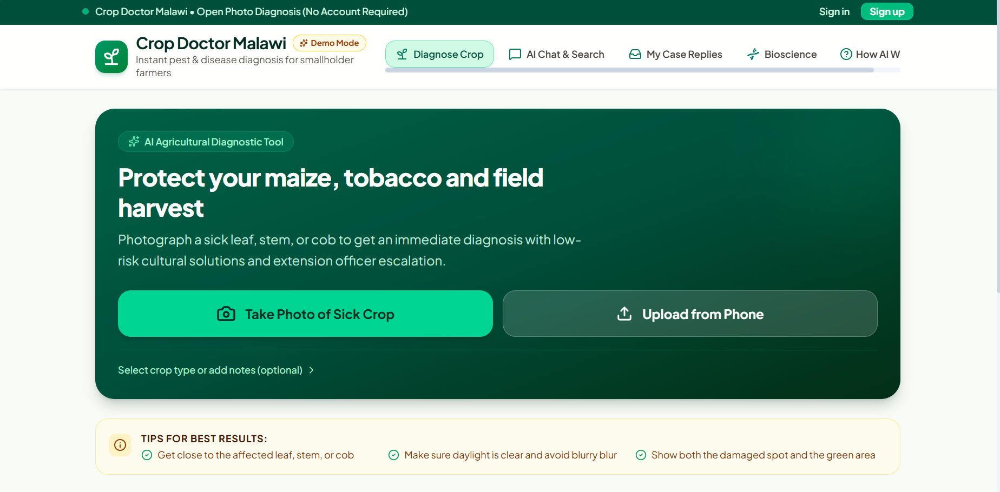
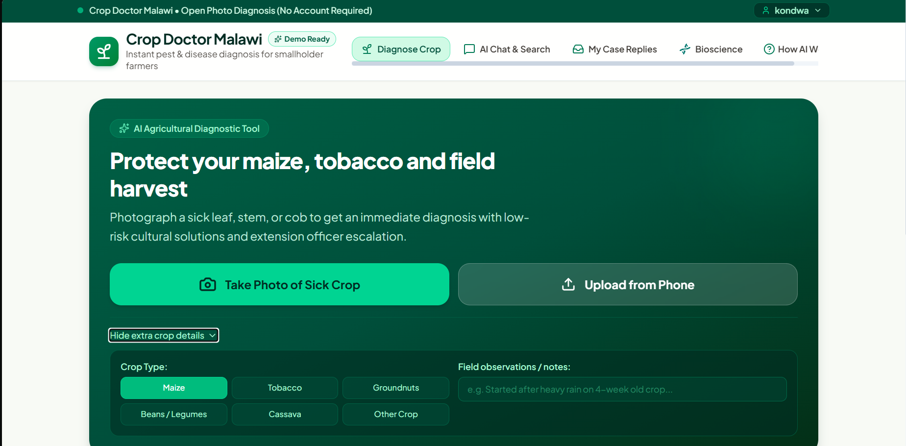
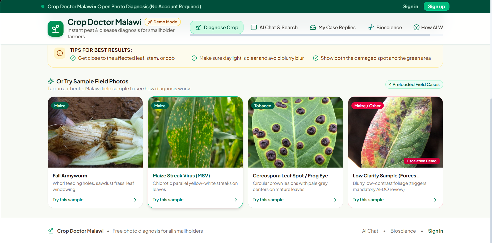
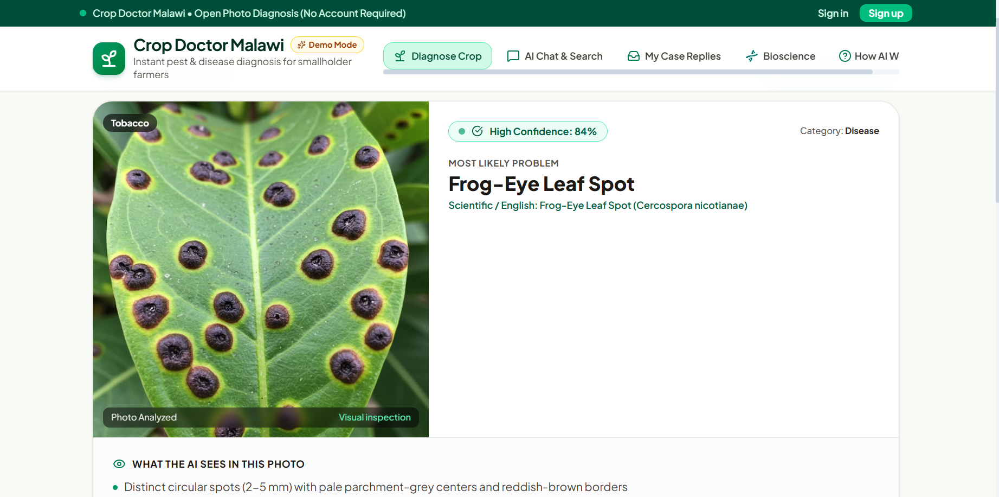
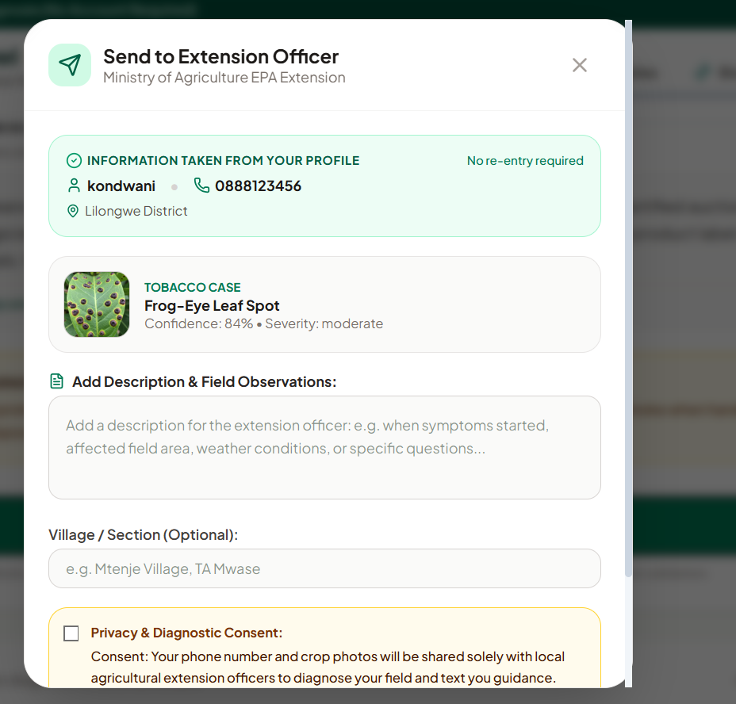
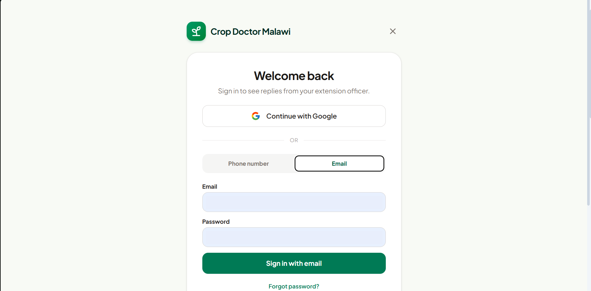
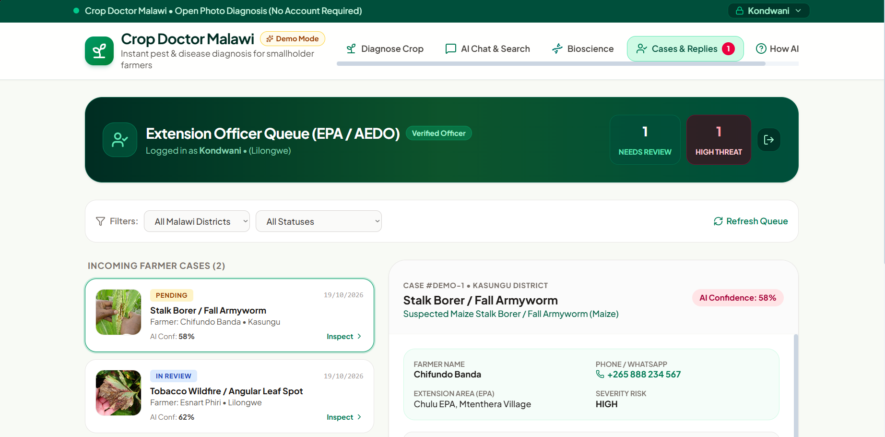

# Crop Doctor Malawi

Instant pest and disease diagnosis for smallholder farmers in Malawi. A farmer photographs a sick maize, tobacco or groundnut plant, gets an AI diagnosis with low-risk cultural solutions, and can escalate the case to a Ministry of Agriculture extension officer (EPA / AEDO) when the AI is unsure.

This repository contains the demo of my web app submission for the AI hackathon.

## Screenshots

### Diagnose a crop
Farmers can take a photo or upload one from their phone, with no account required. Choosing a crop type and adding field notes is optional.

### Try a sample case
Four preloaded Malawi field samples let anyone see how a diagnosis works. The low-clarity sample demonstrates the mandatory extension officer review.

### AI diagnosis
The result shows the most likely problem, a confidence score, and what the AI sees in the photo.

### Escalate to an extension officer
Contact details come from the farmer's profile, so there is no re-entry. The farmer adds observations and gives consent before the phone number and photos are shared.

### Sign in
Farmers sign in to see replies from their extension officer, using Google, phone number or email.

### Extension officer queue
Verified officers see incoming farmer cases, filterable by district and status, with AI confidence, severity and the farmer's contact details.

